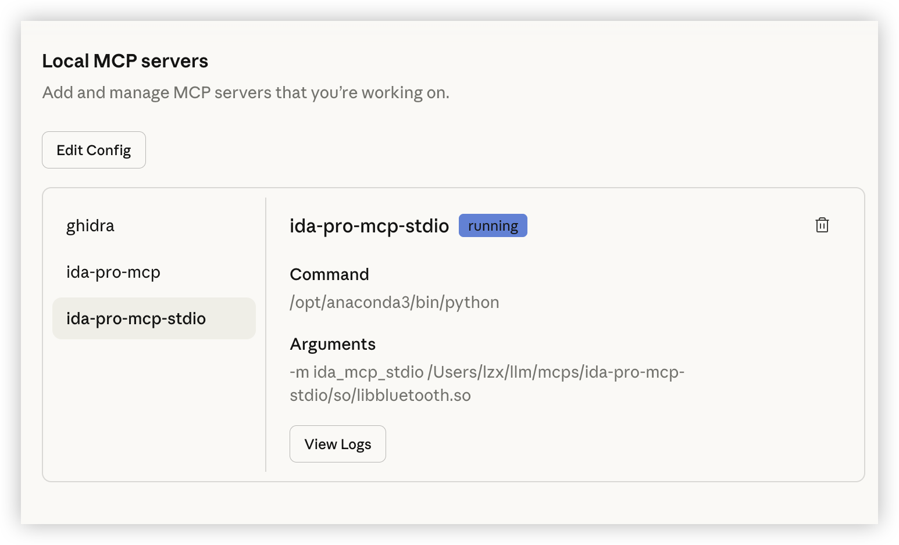
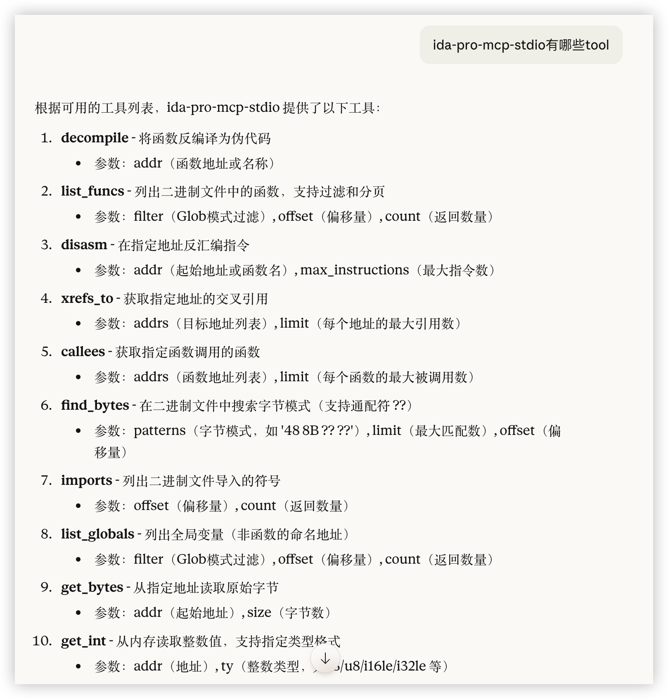
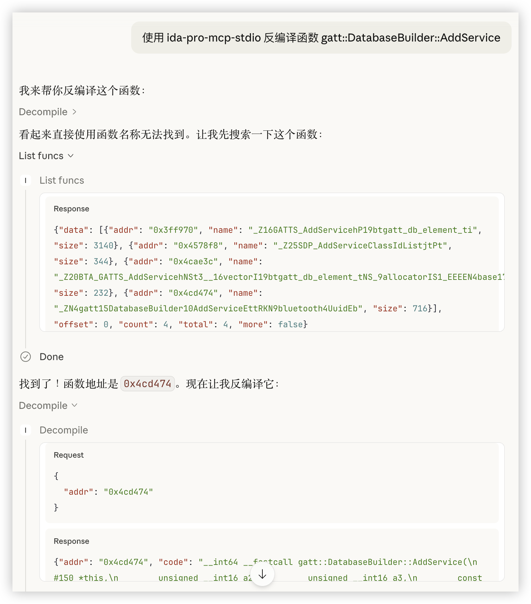

# IDA Pro MCP stdio 使用指南

## 项目简介

IDA Pro MCP stdio 是一个简化的 IDA Pro MCP（Model Context Protocol）服务器，使用 stdio 传输和 idalib（无头模式）进行二进制分析。该项目消除了对 HTTP 传输和线程同步的需求，提供了一个轻量级的二进制分析解决方案。

## 安装

### 基础安装

```bash
pip install .
```

### 开发模式安装

```bash
pip install -e ".[dev]"
```

### 前置要求

- Python >= 3.10
- IDA Pro >= 9.0（需要 idalib 支持）
- `idapro` Python 包（由 IDA Pro 安装目录提供，非 PyPI 包）

### IDADIR 环境变量

服务器启动时会自动检测 IDA Pro 安装路径并设置 `IDADIR` 环境变量，支持以下常见位置：

- **macOS**: `/Applications/IDA*.app/Contents/MacOS/`
- **Linux**: `/opt/idapro`, `/opt/ida`, `~/idapro`
- **Windows**: `Program Files/IDA*`

如果已手动设置 `IDADIR`，服务器不会覆盖。如果 IDA 安装在非标准位置且自动检测失败，需手动设置：

```bash
export IDADIR=/path/to/ida
```

## 使用方式

### 1. 作为 MCP 服务器（stdio）

直接从命令行启动服务器：

```bash
ida-mcp-server /path/to/binary.exe
```

启用详细日志：

```bash
ida-mcp-server /path/to/binary.exe --verbose
```

### 2. 与 MCP 客户端集成

#### Claude Desktop 配置

在 Claude Desktop 配置文件 (`claude_desktop_config.json`) 中添加：

```json
{
  "mcpServers": {
    "ida-pro-mcp-stdio": {
      "command": "/opt/anaconda3/bin/python",
      "args": ["-m", "ida_mcp_stdio", "/Users/lzx/llm/mcps/ida-pro-mcp-stdio/so/libbluetooth.so"]
    }
  }
}
```









### 3. Python 客户端使用

项目提供了三种客户端使用方式，适用于不同场景。详细说明请参考 `examples/README.md`。

#### 方式 A: 自动启动服务端（推荐）

客户端自动启动和管理服务端进程，最简单的使用方式。

```python
from ida_mcp_stdio import IDAMCPClient

# 使用上下文管理器自动清理资源
with IDAMCPClient("binary.exe", verbose=True) as client:
    # 初始化连接
    info = client.initialize()
    print(f"连接到: {info['serverInfo']['name']}")
    
    # 列出函数
    funcs = client.list_funcs(count=10)
    for func in funcs["data"]:
        print(f"{func['addr']} {func['name']}")
    
    # 反编译函数
    code = client.decompile("main")
    print(code["code"])
```

**运行示例：**
```bash
python examples/basic_usage.py /path/to/binary.exe
```

#### 方式 B: 连接到独立运行的服务端

客户端主动启动服务端进程，但有更多控制权，适合调试场景。

```python
from examples.connect_to_running_server import PipeBasedMCPClient

command = ["python", "-m", "ida_mcp_stdio", "binary.exe"]
with PipeBasedMCPClient.connect_to_command(command) as client:
    client.initialize()
    funcs = client.call_tool("list_funcs", {"count": 10})
    print(funcs)
```

**运行示例：**
```bash
python examples/connect_to_running_server.py --binary /path/to/binary.exe
```

#### 方式 C: 通过管道连接（高级用法）

服务端和客户端完全独立运行，通过 shell 管道连接，适合集成到其他工具。

```bash
# 通过管道连接
python -m ida_mcp_stdio binary.exe 2>/dev/null | \
    python examples/separate_server_client.py
```

**使用场景对比：**

| 场景 | 推荐方式 | 示例文件 |
|------|---------|---------|
| 日常分析任务 | 自动启动 | `basic_usage.py` |
| 调试服务端代码 | 独立进程 | `connect_to_running_server.py` |
| IDE 集成 | 管道连接 | `separate_server_client.py` |
| 批量处理 | 自动启动 | `basic_usage.py` |

## 可用工具

### 分析工具 (analysis)

#### decompile - 反编译函数

将函数反编译为伪代码。

```python
result = client.decompile("main")
# 或使用地址
result = client.decompile("0x401000")
```

**返回值：**
```python
{
    "addr": "main",
    "code": "int __cdecl main(int argc, const char **argv) { ... }",
    "error": None
}
```

#### list_funcs - 列出函数

列出二进制文件中的所有函数，支持过滤和分页。

```python
# 列出前 50 个函数
funcs = client.list_funcs(count=50)

# 使用 glob 模式过滤
funcs = client.list_funcs(filter="sub_*", count=20)

# 分页
funcs = client.list_funcs(offset=50, count=50)
```

**返回值：**
```python
{
    "data": [
        {"addr": "0x401000", "name": "main", "size": 256},
        ...
    ],
    "offset": 0,
    "count": 50,
    "total": 1234,
    "more": True
}
```

#### disasm - 反汇编

反汇编指定地址的指令。

```python
result = client.disasm("main", max_instructions=20)
```

**返回值：**
```python
{
    "addr": "main",
    "function": "main",
    "lines": [
        {"addr": "0x401000", "text": "push rbp", "size": 1},
        {"addr": "0x401001", "text": "mov rbp, rsp", "size": 3},
        ...
    ],
    "count": 20,
    "error": None
}
```

#### xrefs_to - 获取交叉引用

获取指向指定地址的所有交叉引用。

```python
# 单个地址
xrefs = client.xrefs_to("0x401000", limit=100)

# 多个地址（逗号分隔）
xrefs = client.xrefs_to("0x401000,0x402000", limit=50)
```

**返回值：**
```python
[
    {
        "addr": "0x401000",
        "xrefs": [
            {
                "addr": "0x403000",
                "type": "code",
                "fn": {"addr": "0x403000", "name": "caller_func"}
            },
            ...
        ],
        "more": False
    }
]
```

#### callees - 获取被调用函数

获取指定函数调用的所有其他函数。

```python
callees = client.callees("main", limit=200)
```

**返回值：**
```python
[
    {
        "addr": "main",
        "callees": [
            {"addr": "0x401500", "name": "printf", "type": "external"},
            {"addr": "0x401600", "name": "sub_401600", "type": "internal"},
            ...
        ],
        "more": False
    }
]
```

#### find_bytes - 搜索字节模式

在二进制文件中搜索字节模式，支持通配符 `??`。

```python
# 搜索特定字节序列
matches = client.find_bytes("48 8B ?? ??", limit=1000)

# 跳过前 100 个匹配
matches = client.find_bytes("48 8B ?? ??", limit=100, offset=100)
```

**返回值：**
```python
[
    {
        "pattern": "48 8B ?? ??",
        "matches": ["0x401000", "0x401234", ...],
        "n": 100,
        "cursor": {"next": 200}  # 或 {"done": True}
    }
]
```

#### imports - 列出导入符号

列出二进制文件的所有导入符号。

```python
# 获取所有导入
imports = client.imports()

# 分页获取
imports = client.imports(offset=0, count=50)
```

**返回值：**
```python
{
    "data": [
        {"addr": "0x403000", "name": "printf", "module": "msvcrt.dll"},
        {"addr": "0x403008", "name": "malloc", "module": "msvcrt.dll"},
        ...
    ],
    "offset": 0,
    "count": 50,
    "total": 150,
    "more": True
}
```

#### list_globals - 列出全局变量

列出所有全局变量（非函数的命名地址）。

```python
# 列出所有全局变量
globals = client.list_globals(count=50)

# 使用 glob 模式过滤
globals = client.list_globals(filter="g_*", count=20)
```

**返回值：**
```python
{
    "data": [
        {"addr": "0x404000", "name": "g_config"},
        {"addr": "0x404100", "name": "g_buffer"},
        ...
    ],
    "offset": 0,
    "count": 50,
    "total": 200,
    "more": True
}
```

### 内存工具 (memory)

#### get_bytes - 读取原始字节

从指定地址读取原始字节数据。

```python
result = client.get_bytes("0x401000", size=16)
```

**返回值：**
```python
{
    "addr": "0x401000",
    "size": 16,
    "data": "48 8b 45 f8 48 89 c7 e8 12 34 56 78 90 ab cd ef",
    "error": None
}
```

#### get_int - 读取整数

从指定地址读取整数值，支持多种格式。

```python
# 读取 32 位小端有符号整数
result = client.get_int("0x401000", "i32le")

# 读取 64 位大端无符号整数
result = client.get_int("0x401000", "u64be")

# 支持的类型：i8, u8, i16le, i16be, i32le, i32be, i64le, i64be, u16le, u32le, u64le 等
```

**返回值：**
```python
{
    "addr": "0x401000",
    "ty": "i32le",
    "value": 12345,
    "error": None
}
```

#### get_string - 读取字符串

从指定地址读取字符串。

```python
# 单个地址
strings = client.get_string("0x404000")

# 多个地址
strings = client.get_string("0x404000,0x404100")
```

**返回值：**
```python
[
    {"addr": "0x404000", "value": "Hello, World!", "error": None},
    {"addr": "0x404100", "value": "Configuration", "error": None}
]
```

#### get_segment_bytes - 读取段数据

读取指定段的所有字节数据。

```python
result = client.call_tool("get_segment_bytes", {
    "name": ".text",
    "max_size": 65536
})
```

**返回值：**
```python
{
    "name": ".text",
    "start": "0x401000",
    "end": "0x410000",
    "size": 61440,
    "read_size": 61440,
    "data": "48 8b 45 f8 ...",
    "truncated": False,
    "error": None
}
```

### 类型工具 (types)

#### search_structs - 搜索结构体

按名称子串搜索结构体定义。

```python
structs = client.search_structs("FILE")
```

**返回值：**
```python
[
    {
        "name": "_iobuf",
        "size": 32,
        "cardinality": 8,
        "is_union": False,
        "ordinal": 123
    },
    ...
]
```

#### read_struct - 读取结构体

读取指定地址的结构体字段值。

```python
# 指定结构体类型
result = client.read_struct("0x404000", struct="_iobuf")

# 自动检测类型
result = client.read_struct("0x404000")
```

**返回值：**
```python
{
    "addr": "0x404000",
    "struct": "_iobuf",
    "members": [
        {
            "offset": "0x00000000",
            "type": "char *",
            "name": "_ptr",
            "size": 8,
            "value": "0x0000000000405000"
        },
        {
            "offset": "0x00000008",
            "type": "int",
            "name": "_cnt",
            "size": 4,
            "value": "0x00000064 (100)"
        },
        ...
    ],
    "error": None
}
```

#### export_funcs - 导出函数信息

以多种格式导出函数信息。

```python
# JSON 格式（包含反编译代码）
funcs = client.export_funcs("main", format="json")

# C 头文件格式
funcs = client.export_funcs("main,sub_401000", format="c_header")

# 仅原型
funcs = client.export_funcs("main", format="prototypes")
```

**返回值（json 格式）：**
```python
[
    {
        "addr": "0x401000",
        "name": "main",
        "size": 256,
        "prototype": "int __cdecl main(int argc, const char **argv)",
        "comment": "Program entry point",
        "repeatable_comment": "",
        "code": "int __cdecl main(int argc, const char **argv) { ... }"
    }
]
```

## 完整示例

项目提供了多个示例文件，展示不同的使用场景：

### 示例 1: 基本用法（自动启动服务端）

文件：`examples/basic_usage.py`

展示如何：
1. 自动启动服务端并连接
2. 列出可用工具
3. 列出函数
4. 反编译函数
5. 反汇编代码

运行：
```bash
python examples/basic_usage.py /path/to/binary.exe
```

### 示例 2: 连接到独立服务端

文件：`examples/connect_to_running_server.py`

展示如何：
1. 启动独立的服务端进程
2. 通过 pipes 连接和通信
3. 查看服务端日志输出

运行：
```bash
python examples/connect_to_running_server.py --binary /path/to/binary.exe
```

### 示例 3: 管道连接（高级）

文件：`examples/separate_server_client.py`

展示如何：
1. 通过 shell 管道连接服务端
2. 实现完全独立的客户端/服务端架构

运行：
```bash
python -m ida_mcp_stdio binary.exe 2>/dev/null | \
    python examples/separate_server_client.py
```

更多详情请参考 `examples/README.md`。

## 错误处理

所有工具调用都会返回包含 `error` 字段的字典。如果操作成功，`error` 为 `None`；如果失败，`error` 包含错误信息。

```python
result = client.decompile("invalid_address")
if result.get("error"):
    print(f"反编译失败: {result['error']}")
else:
    print(result["code"])
```

## 高级用法

### 自定义服务器脚本

```python
client = IDAMCPClient(
    "binary.exe",
    server_script="/path/to/custom_server.py",
    verbose=True
)
```

### 直接调用工具

```python
# 使用 call_tool 方法调用任何工具
result = client.call_tool("decompile", {"addr": "main"})
```

### 列出所有可用工具

```python
tools = client.list_tools()
for tool in tools:
    print(f"{tool['name']}: {tool['description']}")
```

## 许可证

MIT License
